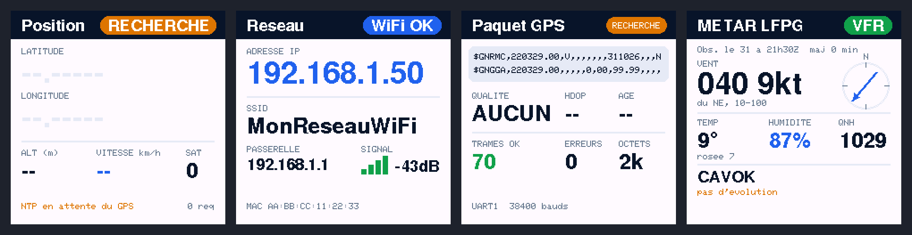
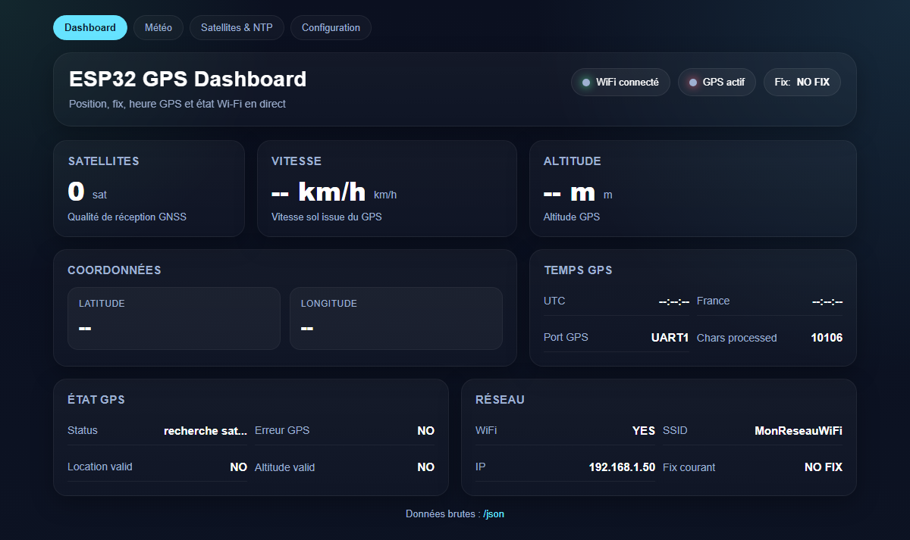
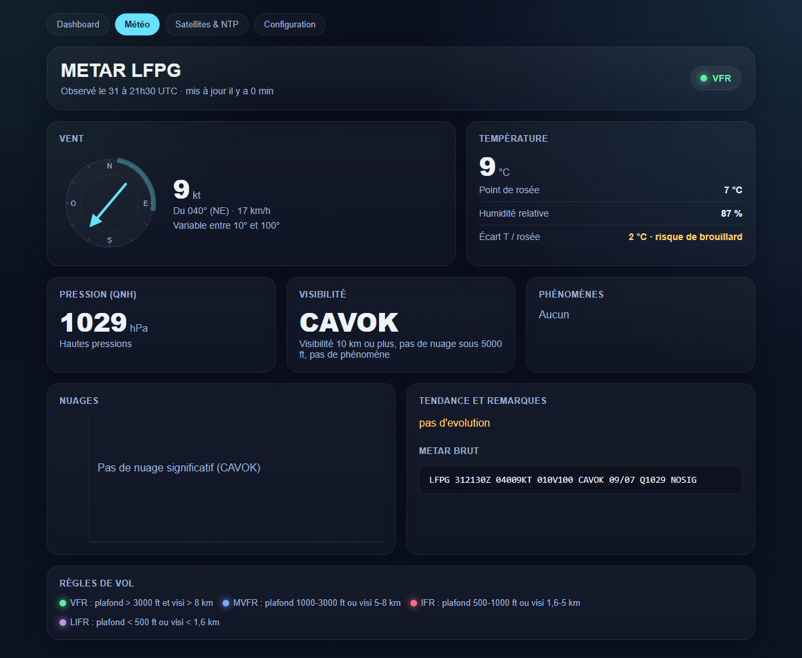
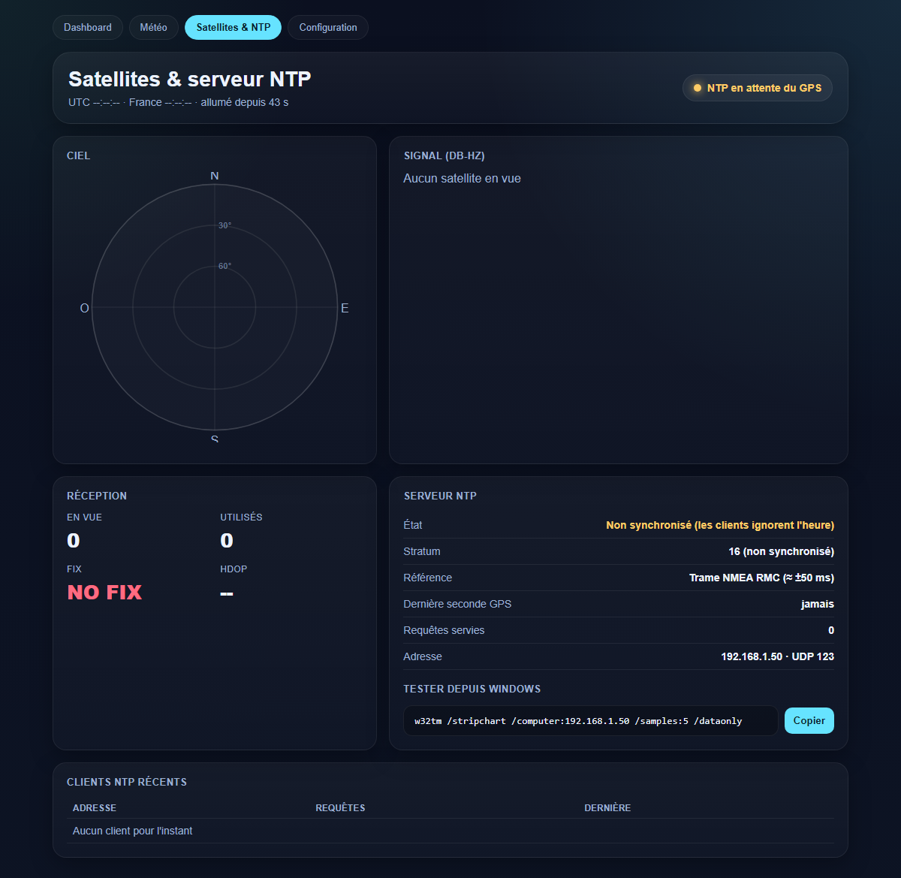
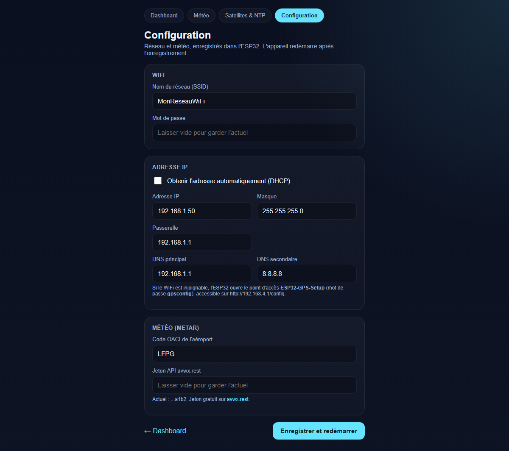

# ESP32 GPS Dashboard

GPS dashboard on an ESP32-C6 with a u-blox NEO-M8N: TFT screen, web server, stratum 1 NTP server and METAR weather.



| Dashboard | METAR weather |
|---|---|
|  |  |
| **Satellites and NTP** | **Configuration** |
|  |  |

*Anonymized screenshots (IP, SSID, MAC and position replaced), taken without a GPS fix, hence no satellites.*

The user interface (TFT and web pages) is in French.

## Features

- **TFT ST7789 240×240**: latitude, longitude, altitude, speed, satellites, fix status
- **OLED SSD1306 128×32**: UTC and French local time, alternating every 5 s
- **Web server**:
  - `/`: GPS dashboard
  - `/metar`: detailed METAR weather (wind rose, cloud layers, decoded trend)
  - `/sats`: satellite sky plot, per-satellite signal, NTP server status and recent clients
  - `/config`: network, METAR station and AVWX token
  - `/json`, `/metar.json`, `/sats.json`: raw data
  - `/screen.bmp?page=0..3`: TFT screenshot (add `&anon=1` to hide IP, SSID, MAC and position)

Satellite details come from the GSV and GSA sentences. The ESP32 enables them at boot through its TX pin (GPIO2) wired to the GPS RX. `tools/gps_config.ps1` also enables them permanently.

The TFT (light theme, white background) cycles through 4 pages every 10 s, with a slide transition:

1. **Position**: large coordinates, altitude, speed, satellites, NTP status
2. **Network**: IP, SSID, gateway, signal, MAC (or the fallback access point details)
3. **GPS packet**: latest RMC, GGA, GSA and GSV sentences, fix quality, HDOP, age, sentence counters
4. **METAR**: wind with rose, temperature, humidity, QNH, sky, trend

Animations: progress bar until the next page, pulsing fix badge, speed and altitude rolling to the new value, WiFi bars filling up, wind arrow turning. Outside animations, only the badge and the progress bar are sent to the screen, so the NTP server isn't blocked.

## METAR (page 4)

Page 4 of the TFT shows the METAR for the station `METAR_STATION_VALUE` (LFPG in `secrets.example.h`), fetched from [avwx.rest](https://avwx.rest) every 10 minutes and retried every minute on error. The data is decoded and translated into French:

- **Flight rules:** VFR, MVFR, IFR or LIFR, as a colored badge.
- **Wind:** direction and speed, wind rose, gusts and variable sector.
- **Measurements:** temperature and dew point, humidity, QNH.
- **Sky:** visibility, clouds (few, scattered, broken, overcast), weather (rain, fog, thunderstorm...).
- **Trend:** TEMPO or BECMG decoded, for example `TEMPO 0500 FG VV///` becomes "Temporaire: visi 500m, brouillard, ciel invisible" (temporarily: visibility 500 m, fog, sky obscured).

The station and the API token are set in `/config`, where they're stored in NVS. `include/secrets.h` (`METAR_STATION_VALUE`, `AVWX_TOKEN_VALUE`) only provides the defaults. The decoded METAR is also available in `/json`. The avwx.rest HTTPS certificate isn't verified (`setInsecure`).

## NTP server

The ESP32 answers NTP requests (UDP/123) with GPS time, as stratum 1.

- **No fix:** it answers "unsynchronized" (LI = 3, stratum 16), so clients ignore its time.
- **Without PPS (default):** the start of each second is estimated from the arrival of the RMC sentence, minus a fixed latency (`NMEA_LATENCY_US` in `src/gps_clock.cpp`, 60 ms). Accuracy is around ±50 ms. You can tune this latency by comparing against a reference NTP server.
- **With PPS:** wire the GPS TIMEPULSE pin to a free GPIO and set `GPS_PPS_PIN` in `src/main.cpp`. The rising edge then gives the exact start of the second (refid `PPS`).
- **Losing sync:** if no valid RMC sentence arrives for 30 s, the server goes back to "unsynchronized".

Test from Windows (replace the address with your ESP32's IP):

```powershell
w32tm /stripchart /computer:192.168.1.50 /samples:5 /dataonly
```

The NTP status (sync, source, request count) is shown in `/json` and at the bottom of TFT page 1.

## Network configuration

The `/config` page lets you change the SSID, password, DHCP or static IP, netmask, gateway and DNS. Settings are stored in NVS and the ESP32 reboots. `include/secrets.h` only provides the defaults.

If the WiFi can't be reached at boot, the ESP32 opens the **ESP32-GPS-Setup** access point (password `gpsconfig`, change `SETUP_AP_PASS` in `src/main.cpp`). The configuration page is then at http://192.168.4.1/config. The access point closes as soon as the WiFi is back.

## Hardware and wiring

The board is a **[Waveshare ESP32-C6-LCD-1.3](https://www.waveshare.com/esp32-c6-lcd-1.3.htm)**: ESP32-C6 (RISC-V, Wi-Fi 6, Bluetooth 5), 4 MB flash, 1.3" 240×240 IPS screen with an ST7789V2 controller, USB-C, microSD slot and RGB LED. The TFT pins below are the ones wired on the board.

<p align="center">
  
  
</p>
<p align="center"><sub>Photos © Waveshare, from the <a href="https://docs.waveshare.com/ESP32-C6-LCD-1.3">product documentation</a>.</sub></p>

- [Product documentation](https://docs.waveshare.com/ESP32-C6-LCD-1.3)
- [Schematic, datasheets and examples](https://docs.waveshare.com/ESP32-C6-LCD-1.3/Resources-And-Documents)
- GPS: [u-blox NEO-M8N](https://www.u-blox.com/en/product/neo-m8-series) module
- Clock screen: SSD1306 128×32 I²C OLED

To force download mode (if the board doesn't restart after flashing), hold **BOOT** while plugging in USB, or press **RESET**.

| Function | ESP32 GPIO |
|---|---|
| GPS TX → ESP RX (UART1) | 1 |
| GPS RX ← ESP TX (optional) | 2 |
| TFT SCLK / MOSI | 7 / 6 |
| TFT CS / DC / RST / BL | 14 / 15 / 21 / 22 |
| OLED SDA / SCL (I²C, address 0x3C) | 23 / 20 |

The GPS is powered from 3.3 V, with a common ground with the ESP32.

## GPS configuration

The firmware expects on the module's UART1:

| Setting | Value |
|---|---|
| Baud rate | 38400 baud, 8N1 |
| NMEA sentences | RMC + GGA + GSA + GSV + ZDA (VTG, GLL off) |
| Constellations | GPS + Galileo + GLONASS |
| SBAS | EGNOS only |
| Dynamic model | Portable |
| PPS | 1 Hz, 100 ms, UTC aligned, only with a fix |

To apply this configuration, connect the module to the PC over USB, then run:

```powershell
powershell -ExecutionPolicy Bypass -File tools\gps_config.ps1 -Port COM20
```

To go through a USB-serial adapter wired to the module's UART1, add `-ViaUart1`, with `-Baud 9600` for a new module or `-Baud 38400` for a module that's already configured.

The script saves the configuration to flash, then reads it back from the module.

## Building

[PlatformIO](https://platformio.org/) project. Arduino support for the ESP32-C6 comes from the pioarduino platform.

1. Copy `include/secrets.example.h` to `include/secrets.h` and fill in the WiFi SSID and password, the AVWX token and the METAR station.
2. Check the default static IP, gateway and DNS in the `NetConfig` struct in `src/main.cpp` (they can be changed later from `/config`).
3. Build and flash:

```bash
pio run -t upload
pio device monitor
```

On Windows, `platformio.ini` sets `core_dir = C:/pio`: the ESP32 packages contain paths longer than the 260-character limit when installed under the user profile.

## Time

- Time is only shown with a valid GPS fix. Before that, the u-blox may output the time from its internal clock, often wrong without a backup battery.
- French local time is computed from UTC: UTC+2 from the last Sunday of March to the last Sunday of October, at 01:00 UTC, and UTC+1 the rest of the year.
